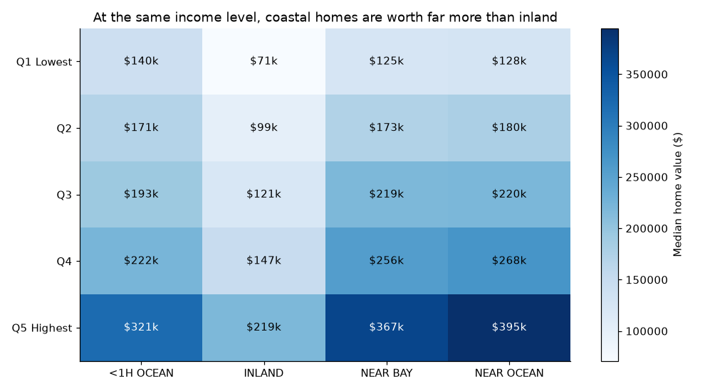

# California Housing: Market Analysis for Retail Site Planning

**Python (pandas, scikit-learn) · MySQL · Data cleaning · Segmentation · KPIs · What-if analysis**

## The business problem
A national retailer wants to rank California markets for new stores and marketing spend. Which areas have the strongest customer base, and what drives local wealth? This project uses home values and household income from 20,640 California neighbourhoods (1990 census) to show where spending power is concentrated.

## Key findings
| # | Finding |
|---|---|
| 1 | **Income is the #1 driver of home value.** Correlation is 0.69, and income is the model's top feature. Top-income neighbourhoods are worth **3.3x** the lowest ($322k vs $99k median). |
| 2 | **Location is #2.** The median inland home is **$108.5k**, against **$215k–$234k** on the coast. At the *same* income, coastal homes are worth about 1.5–2x more. |
| 3 | **Los Angeles is the biggest market.** It has **36% of California households** and a **$152bn** income pool, 2.8x the San Francisco area. |
| 4 | **San Jose has the richest customers.** Median household income is $48.9k and median home value is $267k, but the market is smaller. |
| 5 | **Affordability splits the state.** Coastal homes cost 5.4–6.1x yearly income, inland homes 3.6x. In **Sacramento, 68%** of high-income neighbourhoods are still affordable, against 11–16% in the Bay Area. |
| 6 | **The model is reliable for scenario planning.** A Random Forest explains **82%** of the variation (R² 0.82) with a typical error of **$32k (18%)**, **42% lower** than a simple segment-average baseline. |
| 7 | **What-if:** a +$10k rise in local income lifts predicted home value by about **$30.6k (+17.5%)**, more on the coast (+$36k) than inland (+$27k). |



## Recommendations
1. **Los Angeles first, for volume.** It has the largest customer base and income pool, so it suits high-traffic stores and most of the marketing spend.
2. **Lean premium in San Jose and San Francisco**, balanced with strong value lines. Incomes are high, but housing absorbs much of them.
3. **Make Sacramento and inland markets value-led growth markets.** Many high-income households there still have budget left after housing.
4. **Plan by segment (income band × location), not state averages.**
5. **Validate with current census (ACS) data and real store sales** before acting. This data is from 1990.

## How the analysis was done
1. **Data quality checks:** 0 duplicates, 1% missing bedroom counts, 4.7% of home values capped at $500,001, and a 5-row ISLAND category.
2. **Cleaning:**
   - Missing bedrooms were filled using the typical bedrooms-per-room ratio.
   - Capped and odd rows were *flagged*, not deleted.
   - New columns: income in dollars, per-household ratios, an affordability ratio, income quintiles and metro trade areas (nearest of 6 big cities within 60 km).
3. **KPIs:** households, median income, median home value, value-to-income ratio, income pool.
4. **Segmentation:** income quintile × location type, and metro market ranking.
5. **Model:** a segment-median baseline vs Linear Regression vs Random Forest, tested on a 20% hold-out set split evenly across income levels. Permutation importance shows which features drive the predictions.
6. **What-if:** raise income by $5k, $10k and $20k and measure the change in predicted value.
7. **SQL:** the same analysis in MySQL, covering views, CTEs, joins, window functions (`NTILE`, `ROW_NUMBER`, `RANK`, `SUM() OVER`), pivots and a spatial distance function. See [`sql/QUERY_GUIDE.md`](sql/QUERY_GUIDE.md).

## Model results (20% hold-out test set, 4,128 neighbourhoods)
| Model | R² | Typical error (MAE) | % error (MAPE) |
|---|---|---|---|
| Segment-median baseline | 0.52 | $55.4k | 27.5% |
| Linear Regression | 0.65 | $49.0k | 28.7% |
| **Random Forest** | **0.82** | **$32.1k** | **18.1%** |

## Limitations
- The data is from 1990, so the dollar levels are outdated. The patterns are what carry over.
- Values above $500k and incomes above $150k are capped, so the richest areas are understated.
- Each row is a neighbourhood average, not an individual home or customer.
- What-if results are model predictions, not proof of cause and effect.
- Metro trade areas are a simple 60 km radius around 6 cities.

## Project structure
```
├── house_prices_analysis.ipynb   Main analysis: quality checks → cleaning → KPIs → segments → model → what-if → recommendations
├── data/
│   ├── housing.csv               Raw data (California census, 20,640 rows)
│   └── housing_clean.csv         Cleaned data with new columns (created by the notebook)
├── sql/
│   ├── 01_create_and_load.sql    Creates the MySQL database and tables, loads all rows
│   ├── 02_analysis_queries.sql   8 business queries
│   └── QUERY_GUIDE.md            Plain-English explanation and results for each query
├── images/                       Charts saved by the notebook
├── archive/                      Original coursework (notebooks and scripts), kept for reference
├── CHANGES.md                    What was changed in the clean-up, and why
└── requirements.txt
```

## How to run
```bash
pip install -r requirements.txt
jupyter notebook house_prices_analysis.ipynb      # run all cells
```
For SQL, open `sql/01_create_and_load.sql` in MySQL Workbench and run it, then run the queries in `sql/02_analysis_queries.sql` one by one.

## Data source
California Housing dataset (1990 U.S. Census), as used in *Hands-On Machine Learning with Scikit-Learn* by Aurélien Géron.
